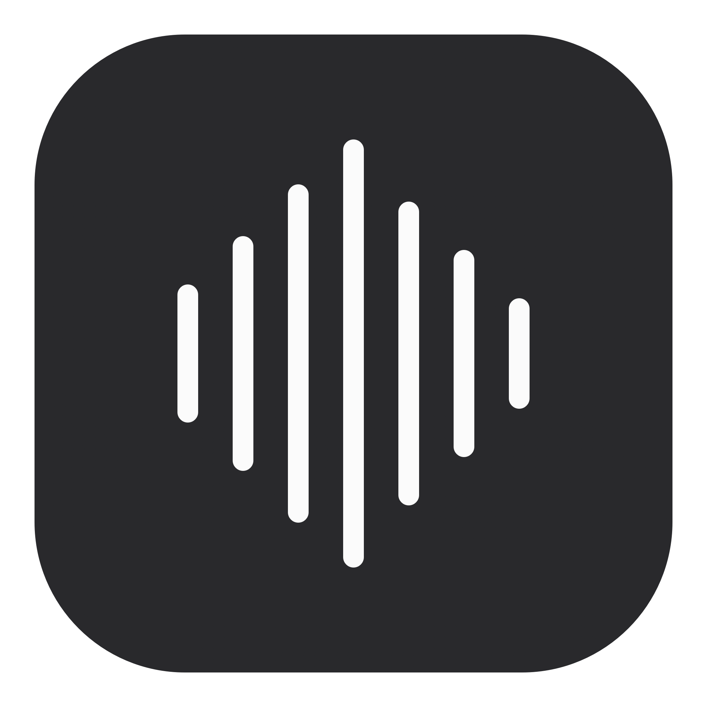
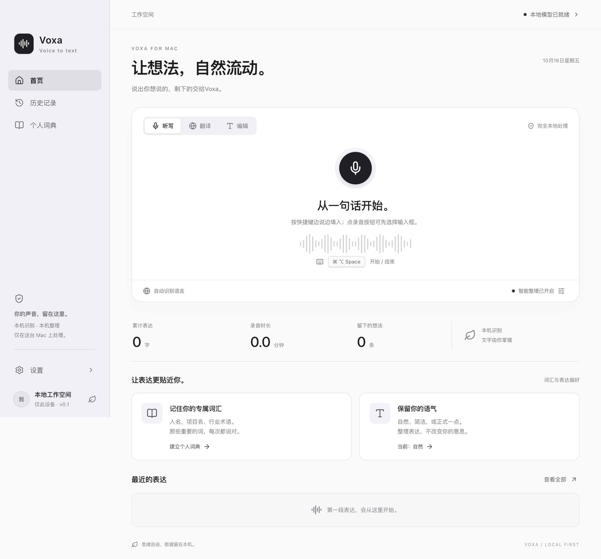
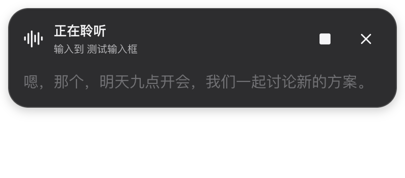

<div align="center">


# Voxa — an open-source Typeless alternative for macOS

**Your voice. Your Mac. Your words.**

Local-first AI voice dictation with Whisper, on-device text cleanup, and a quiet floating panel.

[中文](README.zh-CN.md) · [Get started](#get-started) · [Troubleshooting](docs/TROUBLESHOOTING.md) · [Roadmap](docs/ROADMAP.md) · [Report compatibility](https://github.com/EricHong123/voxa/issues/new?template=compatibility.yml)


[](https://github.com/EricHong123/voxa/actions/workflows/ci.yml)

</div>

Voxa is an **open-source, local-first Typeless alternative** for people who want to speak instead of type and run the models on their own Mac. No Voxa account, subscription, or cloud API key is required. Install the dependencies and download the models once; the bundled workflow performs inference locally.

**Early alpha, source installation only.** Input delivery depends on each app's Accessibility support. Live draft replacement is experimental; universal app compatibility and Typeless feature parity are not claimed. The interface is currently Chinese; English documentation is provided below.



*Actual application UI from a clean test profile. No private dictation history is shown.*

## Why Voxa?

- **Speak → clean up → write.** Local Whisper transcription plus optional Qwen text cleanup, translation, and selected-text editing.
- **A small floating panel.** Read the transcript without opening the full app. See actual additions and deletions during cleanup.
- **Experimental live drafts.** Recognition snapshots can update the selected input while you speak. Revisions replace this session's text instead of appending the whole transcript again.
- **Your vocabulary.** Add names and project terms to a personal dictionary. Search, copy, delete, or export local history.
- **Guarded delivery.** Manual edits, cursor movement, or a changed target stop further live replacements. Unsupported fields retain a copyable result.
- **Optional voice-to-Enter.** Enable it explicitly, then end dictation with “确认发送”. Voxa strips the command and only posts Enter after checking the target and complete draft. Enter can send a message or submit a form; it does not prove delivery.



*HUD preview with synthetic test text. This image demonstrates UI rendering, not verified insertion into another app.*

## Get started

Target: **macOS on Apple Silicon**. Development has been exercised on an M5 Mac with 24 GB RAM; this is not a minimum hardware requirement. Intel Macs, Windows, and Linux are not validated.

Prerequisites: Git, Node.js **22.12+**, npm, Xcode Command Line Tools, and [Homebrew](https://brew.sh/). Model downloads total roughly **1.84 GB**; allow extra space for dependencies and the packaged app.

```sh
xcode-select --install  # skip if already installed
brew install whisper.cpp llama.cpp

git clone https://github.com/EricHong123/voxa.git
cd voxa
npm ci
npm run models
npm run native
npm start
```

The downloader uses pinned Hugging Face revisions and requires Internet access. It currently validates file size, not a cryptographic checksum. Runtime binaries are provided by Homebrew, not bundled by Voxa. The app looks for `whisper-server` and `llama-server` in `/opt/homebrew/bin` and `/usr/local/bin`.

For a local app bundle:

```sh
npm run pack
open release/mac-arm64/Voxa.app
```

This produces an **ad-hoc signed development bundle**, not a notarized one-click installer. Rebuilding can invalidate macOS Accessibility authorization. Keep a stable app path and follow [permission recovery](docs/TROUBLESHOOTING.md) after updates. There is no published prebuilt download yet.

### First dictation

1. Open Settings (设置); wait until both local models show connected. Choose Chinese (中文) for primarily Chinese speech, or automatic detection as needed.
2. Allow microphone access when prompted. Enable **Voxa** under macOS **Privacy & Security → Accessibility** for input delivery.
3. Click a normal text input in another app. Use **⌘⌥Space** to start and stop. Existing profiles keep their configured shortcut; **Control + Z** is available in Settings.
4. Speak, then pause for about 2.5 seconds to finish automatically, or press the shortcut again. Live input is enabled by default for dictation, where supported.
5. If no text arrives, use **Settings → 测试填入 / 测试实时填入** and click the target within five seconds. If the field remains unreadable, copy the retained result.

The main record button also offers a five-second target-selection countdown in live dictation mode. **Escape stops processing but leaves text already inserted.** Disable silence completion for long thinking pauses. Each recording is limited to five minutes.

## What “real-time” means here

Voxa periodically submits an audio snapshot, with a 1.2-second scheduling interval and one inference request at a time. Model inference adds latency. **This is not token-by-token streaming ASR.** At the end, a complete transcription and optional cleanup revise the draft. Long sessions can increase work because live mode transcribes the current session snapshot.

| Capability | Current state |
| --- | --- |
| Local recognition and text cleanup | Implemented; tested with synthetic audio and local models |
| Floating transcript and revision display | Implemented; desktop tests |
| Final input delivery | Guarded native implementation; a user confirmed one fixed-text insertion |
| Live input replacement | Experimental; unit coverage, broad real-app verification pending |
| Voice-to-Enter | Opt-in; guarded; no guarantee of remote message delivery |
| Native one-click distribution | Planned; dependencies and ad-hoc signing remain |
| Continuous listening after each completed segment | Planned |

See [validation notes](VALIDATION.md) for evidence and [the roadmap](docs/ROADMAP.md) for priorities.

## Local processing and privacy

Audio → AudioWorklet → Whisper (`127.0.0.1:17861`) → optional llama.cpp (`127.0.0.1:17862`) → guarded macOS input bridge.

- App inference endpoints accept only literal HTTP `127.0.0.1` addresses and reject redirects. A locally configured backend can have its own network behavior.
- No app analytics or cloud synchronization. Dependencies and models require downloads during setup.
- Raw recordings are kept in memory, not saved by the app. Third-party inference servers control their own logging.
- Settings, dictionary, and up to 500 history items are stored as **plaintext** at `~/Library/Application Support/Voiceleaf/state.json`. The legacy directory preserves existing installations.
- Disabling history prevents new entries; it does not delete existing entries. History can be cleared in the UI.
- Clipboard fallback writes text to the system clipboard. Other software that monitors the clipboard may read it.
- Password fields and inaccessible controls are not supported for automatic delivery.

## Development

```sh
npm test                 # model-independent behavior tests
npm run build            # frontend production build
npm run test:desktop     # Electron UI with a temporary profile
npm run test:models      # local models + prepared audio fixture required
npm run test:recording   # synthetic microphone pipeline + models required
```

See [CONTRIBUTING.md](CONTRIBUTING.md) for architecture, audio fixtures, and review expectations. CI runs unit tests, the web build, and native bridge compilation; it cannot certify permissions or compatibility with your apps.

## Is Voxa related to Typeless?

No. [Typeless](https://www.typeless.com/) is a separate product. “Typeless alternative” describes the voice-to-text workflow Voxa targets, not affiliation, endorsement, equivalent quality, or a fork. This repository publishes Voxa source and original assets; it does not include extracted third-party application code or competitor analysis artifacts.

## Help make local dictation dependable

Try one empty input field and [report the app, version, field type, and result](https://github.com/EricHong123/voxa/issues/new?template=compatibility.yml). Useful compatibility reports matter more than a universal-compatibility claim. If local voice input is something you want to see improve, star the repository and follow the roadmap.

**Discoverability:** open-source Typeless alternative · local voice dictation · offline speech-to-text after setup · Whisper macOS app · on-device AI writing · 中文语音输入 · 本地语音转文字.

## License and acknowledgments

Voxa source is [MIT licensed](LICENSE). Dependencies and downloaded model weights retain their own licenses; see [THIRD_PARTY_NOTICES.md](THIRD_PARTY_NOTICES.md). Built with Electron, React, Swift, whisper.cpp, llama.cpp, and Qwen.
